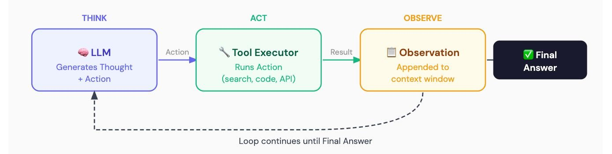

# AI Agent Harness

### A lightweight execution runtime for reliable AI agents.

Provider independent TypeScript runtime for building and inspecting AI agent executions. The core owns the tool loop, schema validation, approvals, limits, context bounds, events, and usage accounting.

*The runtime provides cooperative cancellation and workspace path checks. It is not a process sandbox and does not provide hard isolation for tools or commands.*


### Agent execution Loop



## Requirements

- Node.js 20 or newer
- TypeScript 5.8+ for TypeScript consumers

## Install and run

```sh
npm install agent-harness
```

```ts
import { runAgent, type Model } from "agent-harness";

const model: Model = {
  async generate() {
    return { message: { role: "assistant", content: "Hello from a fake model." } };
  },
};

const result = await runAgent({ model, tools: [] }, "Say hello");
if (result.status === "completed") console.log(result.output);
```

The fake model example needs no API key or network access. See [`examples/fake-agent.ts`](examples/fake-agent.ts) and [Architecture](docs/architecture.md).

## Providers

Provider adapters use Node's `fetch` and have no SDK dependency:

```ts
import { OpenAIModel } from "agent-harness/providers/openai";
import { AnthropicModel } from "agent-harness/providers/anthropic";
import { OllamaModel } from "agent-harness/providers/ollama";
```

Provide credentials from your application environment. The CLI accepts `--provider openai|anthropic|ollama`, `--model`, and `--prompt`; Ollama is the default and can also read a prompt from stdin. Add `--workspace <directory>` to expose workspace filesystem tools. Side-effecting writes prompt for approval in an interactive terminal and are denied when no terminal is available. Set `AGENT_HARNESS_DEBUG=1` to print structured events to stderr.

## Tools and approvals

Tools declare a JSON Schema input and risk level. Inputs are validated using JSON Schema Draft 2020-12 and bounded by a configurable character limit before execution. `write`, `command`, and `external` tools require an application supplied approval policy; without one they are denied. Filesystem tools are created with `createFilesystemTools(workspaceRoot)`. Command tools are built from named developer-configured presets with fixed executable and arguments; they never execute model-supplied shell text.

Optional MCP integration adapts a client implementing the small `MCPClient` interface exported by `agent-harness/mcp`. Adapted tools are treated as external effects and require approval.

## Development

```sh
npm install
npm run check
```

The tests use scripted models and mocked provider transports, and do not require provider credentials. See [Contributing](CONTRIBUTING.md), [Security](SECURITY.md), and [the roadmap](docs/roadmap.md).

## Docker

Build the production CLI image with `docker build -t agent-harness .`. The image runs as the unprivileged `node` user and contains only production dependencies and compiled application files.

For a Compose run, create a `workspace/` directory and set `AGENT_MODEL`, `AGENT_PROMPT`, and the selected provider's API key in your shell. Then run:

```sh
docker compose run --rm agent-harness
```

Compose mounts `./workspace` at `/workspace`; the container root filesystem is read-only. Workspace writes still require interactive approval in the CLI. Set `AGENT_PROVIDER=anthropic` to use Anthropic. For Ollama, set `AGENT_PROVIDER=ollama` and `OLLAMA_BASE_URL` to an Ollama endpoint reachable from the container. Docker does not make the workspace tools a secure sandbox; see [Security](SECURITY.md).

## Limitations

Cancellation is cooperative. Child-process termination is best effort and platform dependent. Workspace path resolution reduces accidental path escape, but cannot prevent races with hostile local processes. Use OS, container, or remote sandboxing for untrusted code. Conversation persistence, retries, streaming, and hard isolation are not currently provided.

## License

MIT. See [LICENSE](LICENSE).
